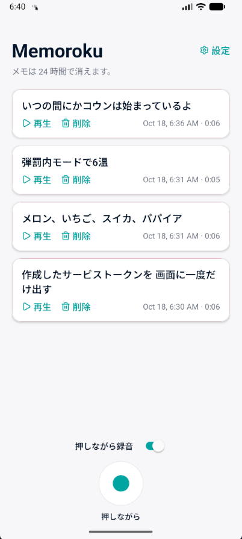
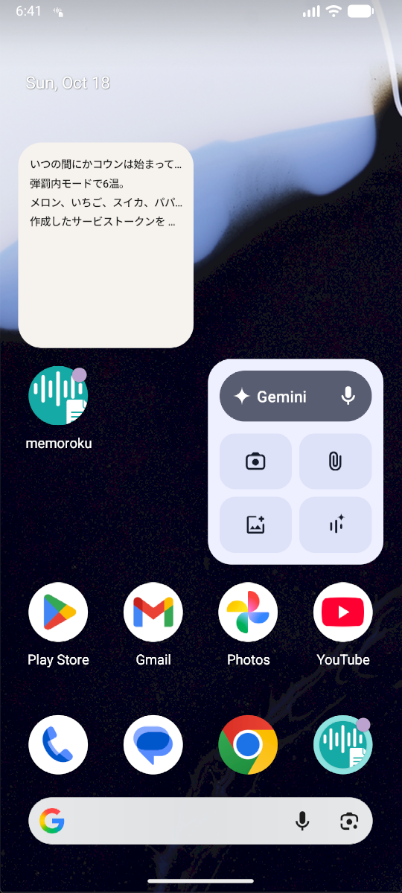
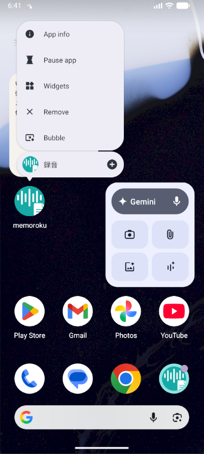
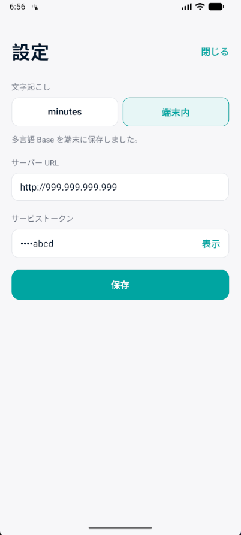

# memoroku

[English](README.md)

短い録音メモのスマホアプリです。録音を端末に残し、minutes に送って文字起こしし、できた短い文をホーム画面のウィジェットに出します。

文字起こしのバックエンドは [minutes](https://github.com/plaodas/minutes) です。このリポジトリにはスマホアプリだけを置きます。話者分け、要約、Word 出力は呼びません。

プロダクトの約束は [docs/promises.md](docs/promises.md) です。

<table>
  <tr>
    <td align="center" width="50%">
      <br>
      アプリメイン画面
    </td>
    <td align="center" width="50%">
      <br>
      ウィジェットメモ表示
    </td>
  </tr>
  <tr>
    <td align="center" width="50%">
      <br>
      ホーム長押しメニュー
    </td>
    <td align="center" width="50%">
      <br>
      設定画面
    </td>
  </tr>
</table>

## 関連リポジトリ

- [minutes](https://github.com/plaodas/minutes): 音声を文字起こしするバックエンド。memoroku は録音をここへ送る。
- [minutes-ext-access](https://github.com/plaodas/minutes-ext-access): 既存の React / Laravel アプリから minutes を呼ぶサンプル。ブラウザは minutes のトークンを持たない。

## できること

- 録音する。音声は端末の保存領域に残り、一覧から再生できる。マイクの許可が済んでいるときは、最初から押しながら録音になる
- minutes へアップロードし、文字起こしが終わるまで待つ
- 完了したら通知し、短い文をウィジェットに出す。タップするとそのメモを開く
- メモは 24 時間で消える。一覧から削除することもできる。消すとき録音ファイルも消す

ウィジェットに録音ボタンはありません。ウィジェットから minutes は呼びません。

サーバーの URL とトークンが空でも録音と再生はできます。アップロードは設定を保存したあとに再開します。

## 必要なもの

- Node.js 20.19 以降、22.13 以降、24.3 以降、または 25 以降
- Android Studio。SDK は API 31 以降。確認は API 31 以降のエミュレータか実機
- 文字起こしサーバーとして起動した [minutes](https://github.com/plaodas/minutes)。WSL で動かすとき、エミュレータから見たホストは `10.0.2.2`

ウィジェットとネイティブ録音があるため、Expo Go では動きません。development build を使います。

iOS の実機確認は Mac と iPhone が揃ってから行います。Windows では `expo run:ios` と `pod install` は実行しません。

## Windows での準備

作業コピーは Windows のディスクに置きます。WSL のパスや `\\wsl$\` では続けません。

```powershell
npm ci --legacy-peer-deps
```

`react` は `19.2.3` に固定してあり、`@expo/ui` が任意で引く `react-dom@19.3.1` と peer が衝突します。`npm install` は使わず、上のコマンドでロックファイルどおりに入れます。

ターミナルから Gradle と SDK が見えるように、ユーザー環境変数を次にします。設定したあとはターミナルを開き直します。

- `JAVA_HOME` は Android Studio 付属の JDK（`C:\Program Files\Android\Android Studio\jbr`）
- `JAVA_TOOL_OPTIONS` は `--enable-native-access=ALL-UNNAMED`。この JDK では、付けないと CMake の設定が失敗する
- `ANDROID_HOME` は `%LOCALAPPDATA%\Android\Sdk`
- PATH に `%JAVA_HOME%\bin`、`%ANDROID_HOME%\platform-tools`、`%ANDROID_HOME%\emulator`

改行コードは LF のままにします。`core.autocrlf` で `gradlew` を CRLF に変換しません。

## 起動

```powershell
npx expo run:android
```

初回は development build を作り、エミュレータか実機に載せます。CMake は Android SDK がビルド中に入れます。別途インストールは不要です。

## 接続

アプリの設定画面に、[minutes](https://github.com/plaodas/minutes) のベース URL とサービストークンを入れます。認証は `Authorization: Bearer` です。ログイン画面はありません。

minutes を WSL で動かし、Android エミュレータからつなぐときは、サーバー URL を `http://10.0.2.2:<minutes の公開ポート>` にします。

## ライセンス

[MIT](LICENSE)
